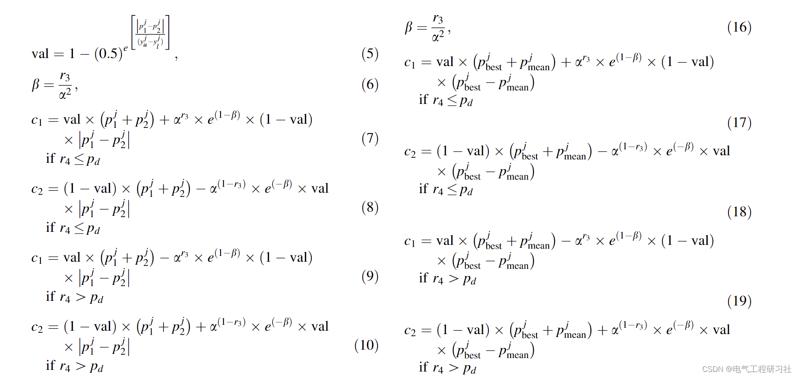
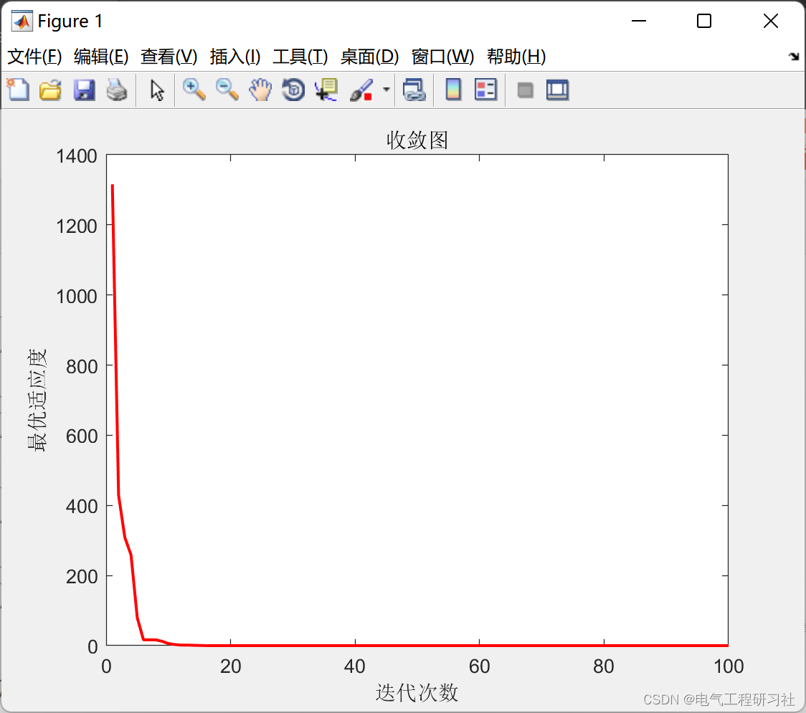
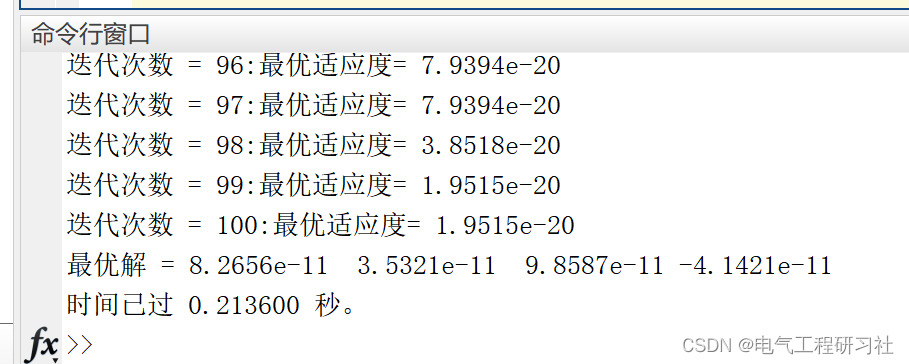
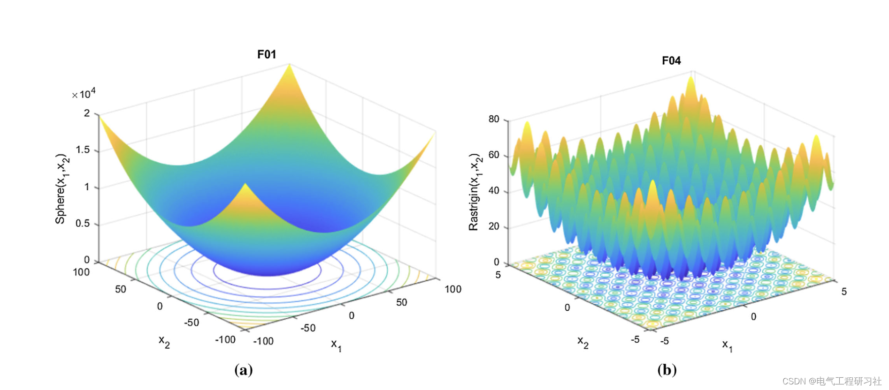
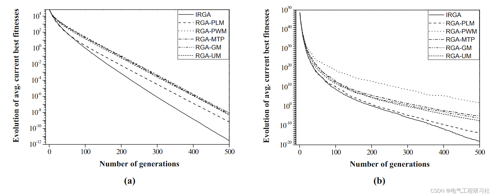
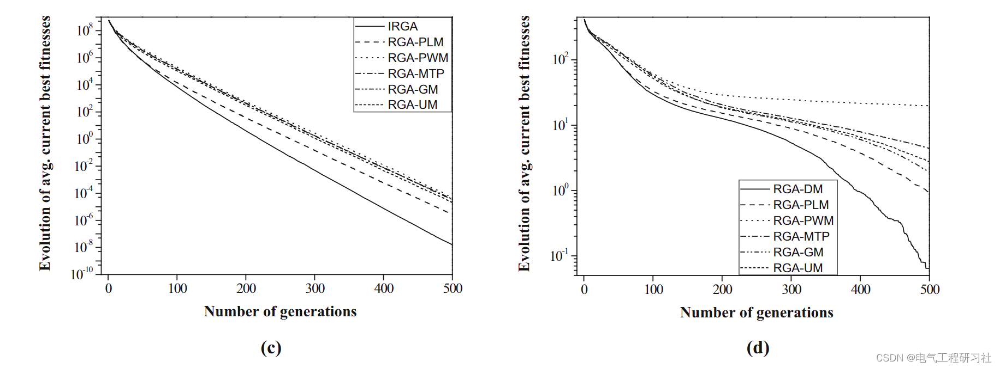
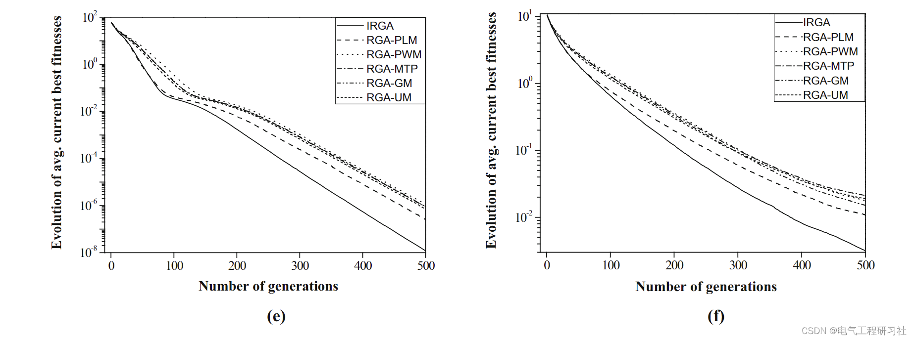
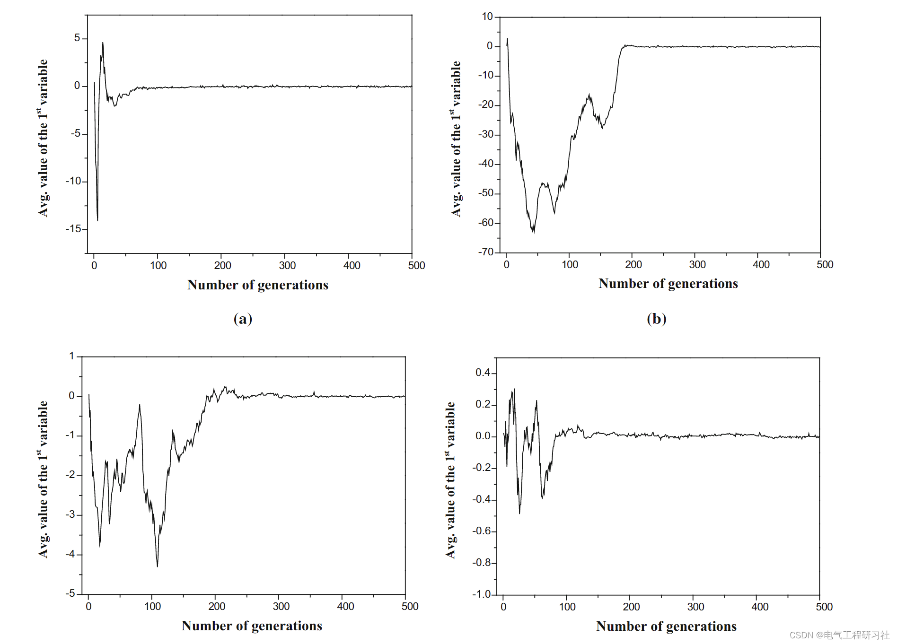
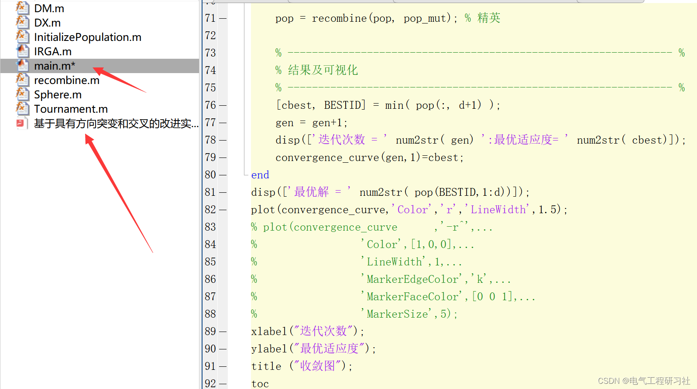

# Improved Genetic Algorithm | Real-valued Genetic Algorithm with Directional Mutation and Crossover (IRGA) to Solve Engineering Optimization Problems (Matlab Code Implementation)

1. Overview of Genetic Algorithms (GA) for solving various optimization problems. The mutation operator also maintains the required level of population diversity in GA. Here, the directional mutation operator and directional crossover (DX) operator are proposed for real-number coded genetic algorithms (RGA) to improve its performance. These evolutionary operators use directional information to guide the search process in the most promising areas in the variable space. The performance of RGA with the proposed mutation operators and directional crossover (DX) was tested on six different complexity benchmark optimization problems, and the results were compared with those of RGAs with other five mutation schemes. It was found that the proposed IRGA outperformed other RGAs in terms of solution accuracy, convergence speed, and computational time, which was firmly established through statistical analysis. In addition, the performance of the proposed IRGA was compared with some recently proposed optimization algorithms. Compared with the above techniques, the proposed IRGA was considered to produce better results. It was also applied to solve five constrained engineering optimization problems, which again demonstrated its superiority. The proposed use of directional information in mutation led to effective search, thus achieving superior performance.
2 Mathematical Model
​Edit
Detailed mathematical model and explanation can be found in Part 4.
3 Running Results
​Edit
​Edit
​Edit
​Edit
​Edit
​Edit
5 References A. K. Das and D. K. Pratihar, "Solving engineering optimization problems using an improved real-coded genetic algorithm (IRGA) with directional mutation and crossover," Soft Computing, vol. 25, pp. 5455-5481, 2021.
6 End Note

## Images

<!-- PAYMENT_BLOCK -->

## Get this dataset

- Payment link (Stripe): [Buy now](https://buy.stripe.com/3cs8yP7sY87d0vu9AB)
- Payment QR code: 

<!-- /PAYMENT_BLOCK -->
